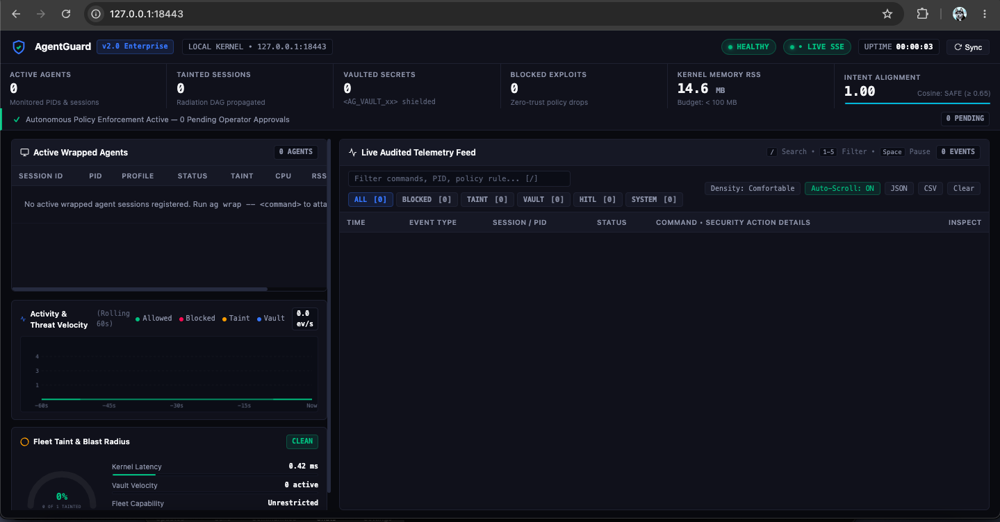
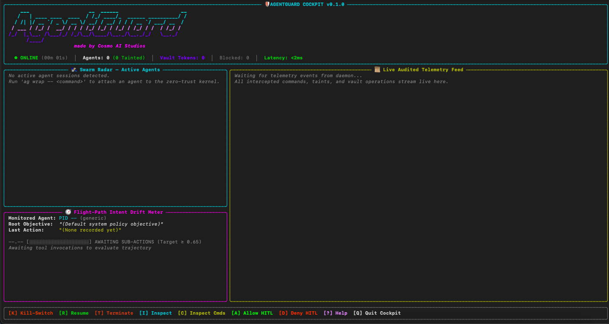

# 🛡️ AgentGuard

```text
   ___                    __   ______                     __
  / _ | ___ ____ ___  ___/ /  / ____/_ _____ _________   / /
 / __ |/ _ `/ -_) _ \/ _  /  / / _ / // / _ `/ __/ _  / /_/ 
/_/ |_|\_, /\__/_//_/\_,_/   \___/ \_,_/\_,_/_/  \_,_/ (_)  
      /___/                                                  
                 made by Cosmo AI Studios
```

**OS-level zero-trust security kernel and telemetry cockpit for autonomous AI coding agents.**

AgentGuard intercepts, classifies, and enforces security policies on every command an AI coding agent executes — before it touches your system. Operating as a machine-wide security supervisor, AgentGuard creates an unbypassable boundary between autonomous agents (Antigravity, Claude Code, Cursor, Codex, Cline, Aider, Hermes, OpenClaw, etc.) and your operating system.

[](LICENSE)
[](https://www.python.org/)
[](#-testing)
[-blueviolet.svg)](#-cross-platform--universal-os-support)
[](https://buymeacoffee.com/cosmoai)
[](mailto:cosmoaistudios@gmail.com)

---

## 📸 Visual Tour

Experience real-time AI security monitoring through AgentGuard's terminal cockpit and visual interfaces:

### Terminal Cockpit TUI (`ag cockpit`)
Live telemetry stream, connected agent swarm radar, intent drift meter, and emergency process kill switch:


### Zero-Trust Command Interception & Telemetry Feed
Live terminal interception displaying real-time session tracking, AST policy evaluation, and audit feeds:


---

## ⚡ Quick Start

```bash
# 1. Clone repository
git clone https://github.com/cosmoaistudios-netizen/AgentGuard.git
cd AgentGuard

# 2. Install package in editable mode
pip install -e .

# 3. Start the AgentGuard security daemon
ag start

# 4. Wrap your autonomous AI agent with zero-trust protection
ag wrap -- agy               # Antigravity agent
ag wrap -- claude            # Claude Code CLI
ag wrap -- cursor            # Cursor editor

# 5. Launch the live terminal cockpit
ag cockpit

# 6. Access the Web DevSecOps Dashboard
# → Open http://127.0.0.1:18443
```

---

## 💻 Agent Wrapping Command Guide

AgentGuard uses the `--` token separator to cleanly pass execution arguments to target agent binaries. The security supervisor intercepts subprocess spawns, injects the zero-trust shell shims, configures dynamic linker hooks, and transparently routes LLM traffic through the local inspection proxy.

### Supported Agent Commands

```bash
# Antigravity Agent (CLI / IDE)
ag wrap -- agy
ag wrap -- antigravity

# Claude Code CLI
ag wrap -- claude

# Cursor Editor & Background Agents
ag wrap -- cursor .

# OpenAI Codex CLI
ag wrap -- codex

# Cline / Roo Code
ag wrap -- cline

# Aider Pair Programming
ag wrap -- aider --model sonnet

# Hermes Autonomous Agent
ag wrap -- hermes

# OpenClaw CLI
ag wrap -- openclaw

# Windsurf Editor
ag wrap -- windsurf

# Goose Developer Agent
ag wrap -- goose session

# Custom Python Scripts & Autonomous Workflows
ag wrap -- python my_autonomous_agent.py
ag wrap -- node runner.js
```

### Wrapping Flags & Options

```bash
# Enable interactive Human-In-The-Loop (HITL) prompt for dangerous mutations
ag wrap --hitl -- agy

# Force a specific security profile instead of auto-detection
ag wrap --profile antigravity -- agy
ag wrap --profile claude-code -- claude

# Disable transparent LLM reverse proxy (proxy port 18443)
ag wrap --no-llm-proxy -- aider

# Custom daemon IPC socket location
ag wrap --socket /tmp/agentguard-custom.sock -- agy
```

When no profile is explicitly specified, AgentGuard automatically detects the target agent from the binary name, script arguments, or `npx`/`uvx` runner and loads its customized security profile.

---

## 🌐 Cross-Platform & Universal OS Support

AgentGuard is architected to run universally across **macOS**, **Linux**, and **Windows**:

| Platform | Support Mode | Interception Architecture | Process Control Mechanism |
|---|---|---|---|
| **macOS** | Native | POSIX shell shim (`ag-sh`) + `DYLD_INSERT_LIBRARIES` | POSIX signals (`SIGSTOP`, `SIGCONT`, `SIGKILL`) |
| **Linux** | Native | POSIX shell shim (`ag-sh`) + `LD_PRELOAD` | POSIX signals & `cgroups` isolation |
| **Windows** | Native (Win32) | Portable Python fallback & `.cmd` batch wrappers | `psutil` Win32 Job API (`NtSuspendProcess`, `NtResumeProcess`, `TerminateProcess`) + `msvcrt` raw console input |
| **Windows** | WSL2 | Full native POSIX shell shim & Unix sockets | Native Linux kernel primitives |

### Native Windows Implementation Details
- **Process Suspension & Kill Switch:** Windows systems lack native POSIX `SIGSTOP`/`SIGCONT` signals. AgentGuard's kernel layer uses `psutil` Win32 job object abstractions to pause, resume, and terminate child processes safely without leaving orphan worker processes.
- **PowerShell & CMD Interception:** Shim directories install `.cmd` launchers alongside Python wrappers, routing intercepted binaries (`git`, `curl`, `rm`, `node`, `python`) directly into policy inspection before native Windows path resolution.
- **Cockpit Console Navigation:** Full-screen terminal cockpit navigation on Windows automatically binds to `msvcrt` raw console key reading for arrow-key navigation and hotkey support (`[K]`, `[H]`, `[Q]`).

---

## 🏗️ Architecture

```
┌─────────────────────────────────────────────────────────┐
│              Autonomous AI Agent (Antigravity, etc.)    │
│                         ↓ commands                      │
│  ┌──────────────────────────────────────────────────┐   │
│  │          Cross-Platform Shell Shim               │   │
│  │     AST parsing · regex classification           │   │
│  │     < 1.5ms read-only fast pass                  │   │
│  └──────────────┬───────────────────────────────────┘   │
│                 ↓ IPC (Unix Domain Socket / Named Pipe) │
│  ┌──────────────────────────────────────────────────┐   │
│  │          AgentGuard Daemon                       │   │
│  │  ┌─────────┐ ┌──────────┐ ┌───────────────┐     │   │
│  │  │  Taint  │ │  Secret  │ │    Intent     │     │   │
│  │  │ Engine  │ │  Vault   │ │   Tracker     │     │   │
│  │  └─────────┘ └──────────┘ └───────────────┘     │   │
│  │  ┌─────────┐ ┌──────────┐ ┌───────────────┐     │   │
│  │  │ Policy  │ │  Memory  │ │    HITL       │     │   │
│  │  │ Engine  │ │  Guard   │ │   Approvals   │     │   │
│  │  └─────────┘ └──────────┘ └───────────────┘     │   │
│  │  ┌─────────┐ ┌──────────┐ ┌───────────────┐     │   │
│  │  │  Audit  │ │   MCP    │ │  Filesystem   │     │   │
│  │  │ Logger  │ │ Gateway  │ │    Guard      │     │   │
│  │  └─────────┘ └──────────┘ └───────────────┘     │   │
│  └──────────────────────────────────────────────────┘   │
│                 ↓ telemetry                              │
│  ┌────────────┐ ┌────────────┐ ┌───────────────────┐    │
│  │  Cockpit   │ │    Web     │ │   Notifications   │    │
│  │   TUI      │ │ Dashboard  │ │ Discord/Telegram  │    │
│  └────────────┘ └────────────┘ └───────────────────┘    │
└─────────────────────────────────────────────────────────┘
```

---

## 🔑 Core Zero-Trust Pillars

### 1. 🔒 Zero-Trust Command Interception
- **Cross-Platform Shim** — Intercepts execution before binaries execute on the host OS.
- **AST + Regex Classifier** — Evaluates command trees against four security classifications: `ALLOW`, `BLOCK`, `HITL` (human approval required), or `AUDIT`.
- **Read-Only Fast Pass** — Sub-1.5ms overhead for safe exploratory commands (`ls`, `cat`, `grep`, `pwd`).

### 2. 🧬 Taint Tracking DAG Engine
- **Session-Level Taint Tracking** — Automatically taints sessions whenever an agent pulls unverified external content (`curl`, `wget`, `git clone`, external API responses).
- **Directed Acyclic Graph (DAG)** — Tracks taint propagation across process trees, intermediate files, and child threads.
- **Egress Confinement** — Blocks outbound connections from tainted sessions to prevent credential exfiltration.

### 3. 🔐 In-Flight Secret Vault
- **Entropy & Pattern Detection** — Identifies API keys, private certificates, and bearer tokens in real-time.
- **Synthetic Token Replacement** — Swaps sensitive secrets with ephemeral `<AG_VAULT_TOKEN_xx>` tokens in memory.
- **Strict Destination Whitelisting** — Detokenizes secrets only when requests target verified, whitelisted API endpoints.

### 4. 🧠 Intent Drift Tracking
- **Goal Alignment Verification** — Compares ongoing shell actions against the initial user objective using cosine similarity.
- **Drift Radar** — Triggers administrative alerts if an agent drifts into unrelated directories or begins system-wide reconnaissance.

### 5. 🛑 Human-in-the-Loop (HITL) Controls
- **Interactive Prompt** — Displays `[A]llow once / [D]eny` prompts directly in the operator's terminal for high-impact mutations.
- **Fail-Closed Guarantees** — If an operator does not respond within the timeout window, the command is denied automatically.

### 6. 🛡️ Memory & Vector DB Guard
- **Sleeper Injection Defense** — Scans vector database writes and memory buffers to prevent prompt injection persistence across sessions.
- **SHA-256 Provenance Stamping** — Cryptographically verifies memory chunk integrity and origin.

### 7. 🌐 MCP Gateway Proxy
- **Tool-Call Inspection** — Transparently audits Model Context Protocol (MCP) JSON-RPC calls.
- **Schema Validation** — Blocks unauthorized tool invocations and malformed parameter payloads.

---

## 📦 Supported Agent Security Profiles

AgentGuard includes tailored YAML security profiles in `agentguard/profiles/`:

| Agent / Framework | Profile File | Default Policy Highlights |
|---|---|---|
| **Antigravity** | `antigravity.yaml` | Full IDE protection, workspace confinement, safe command passthrough |
| **Claude Code** | `claude-code.yaml` | Anthropic endpoint detokenization, git command auditing |
| **Cursor** | `cursor.yaml` | Language server protection, workspace-only disk writes |
| **Codex** | `codex.yaml` | Python runtime isolation, external network lockdown |
| **Cline / Roo Code** | `cline.yaml` | Shell execution sandboxing, credential masking |
| **Aider** | `aider.yaml` | Automated git commit auditing, diff verification |
| **Hermes** | `hermes.yaml` | Autonomous execution guardrails, egress filtering |
| **OpenClaw** | `openclaw.yaml` | Subprocess tree supervision, prompt-injection defense |
| **Windsurf** | `windsurf.yaml` | Cascade tool-call monitoring, filesystem write validation |
| **Goose** | `goose.yaml` | Extension tool authorization, bash shim interception |
| **Generic Agent** | `generic.yaml` | Conservative zero-trust baseline for arbitrary AI agent scripts |

---

## 🖥️ CLI Reference

| Command | Description |
|---|---|
| `ag start` | Start the AgentGuard background daemon |
| `ag stop` | Stop the running daemon cleanly |
| `ag status` | Display daemon status, socket health, and connected agent sessions |
| `ag wrap -- <cmd>` | Wrap an agent command with AgentGuard interception and proxying |
| `ag cockpit` | Launch the real-time terminal monitoring cockpit (TUI) |
| `ag notify setup` | Interactively configure Discord / Telegram security alert webhooks |
| `ag notify test` | Send a synthetic threat alert to configured notification channels |
| `ag siem setup` | Configure Splunk, ELK, or S3 enterprise log export |

---

## 🧪 Testing

AgentGuard maintains a comprehensive, zero-compromise test suite of **541 tests** covering all security tiers:

```bash
# Run entire test suite
pytest -q

# Run unit tests only
pytest tests/unit/ -v

# Run end-to-end tiers
pytest tests/e2e/ -v
```

### Test Coverage Tiers
- **Tier 1:** Core Functional Requirements (R1–R5: shims, vault, taint engine, CLI, policy engine)
- **Tier 2:** Boundaries & Adversarial Edge Cases (deep subshells, huge payloads, false positive filters)
- **Tier 3:** Pairwise Subsystem Interaction (taint + shell shim, vault + egress, proxy + audit)
- **Tier 4:** Real-World Agent Simulation (multi-agent swarms, workspace mutation, prompt injection)
- **Tier 5:** Adversarial Stress & Chaos Hardening (socket bursts, kill switch responsiveness, race conditions)

---

## 📁 Repository Structure

```
AgentGuard/
├── assets/
│   ├── agentguard_cockpit.png          # Cockpit TUI screenshot
│   └── agentguard_terminal.png         # Terminal launcher screenshot
├── agentguard/
│   ├── branding.py                     # ASCII logo & Cosmo AI Studios branding
│   ├── cli.py                          # Unified CLI entry point (`ag`)
│   ├── launcher.py                     # Smart interactive launcher with auto-detection
│   ├── kernel/
│   │   └── process.py                  # Cross-platform process management (Win32 & POSIX)
│   ├── daemon/
│   │   ├── server.py                   # IPC daemon (socket + HTTP server)
│   │   ├── audit.py                    # Dual-tier audit logger
│   │   ├── command_classifier.py       # AST & regex command classifier
│   │   ├── intent.py                   # Intent drift tracker
│   │   ├── memory_guard.py             # Memory & vector DB inspector
│   │   ├── policy_engine.py            # Markdown security policy parser
│   │   ├── taint_engine.py             # Session taint propagation DAG
│   │   └── vault.py                    # In-flight secret vault & tokenization
│   ├── interceptors/
│   │   ├── shell_shim.py               # Shell interceptor & shim manager
│   │   ├── fs_guard.py                 # Filesystem write guard
│   │   └── mcp_gateway.py              # MCP tool-call reverse proxy
│   ├── cockpit/
│   │   ├── app.py                      # Terminal cockpit TUI layout
│   │   ├── radar.py                    # Swarm radar widget
│   │   ├── drift_meter.py              # Intent drift gauge
│   │   └── kill_switch.py              # Emergency process control modal
│   ├── notifications/
│   │   ├── discord.py                  # Discord webhook dispatcher
│   │   └── telegram.py                 # Telegram bot alert dispatcher
│   └── profiles/                       # Agent-specific YAML security profiles
├── security_policy.md                  # Human-readable reference security policy
├── pyproject.toml                      # Modern PEP 621 build configuration
├── setup.py                            # Backward-compatible setup script
└── tests/                              # 541 automated unit and E2E tests
```

---

## ☕ Support Our Work

If AgentGuard helps secure your autonomous AI workflows, please consider supporting continued open-source research and engineering:

[](https://buymeacoffee.com/cosmoai)

**Buy Me a Coffee:** [https://buymeacoffee.com/cosmoai](https://buymeacoffee.com/cosmoai)

---

## 📬 Contact & Inquiries

- **Author & Organization:** Cosmo AI Studios
- **Email:** [cosmoaistudios@gmail.com](mailto:cosmoaistudios@gmail.com)
- **Repository:** [https://github.com/cosmoaistudios-netizen/AgentGuard](https://github.com/cosmoaistudios-netizen/AgentGuard)

---

## 📜 License

Licensed under the [Apache License, Version 2.0](LICENSE).
Copyright © 2026 Cosmo AI Studios.
